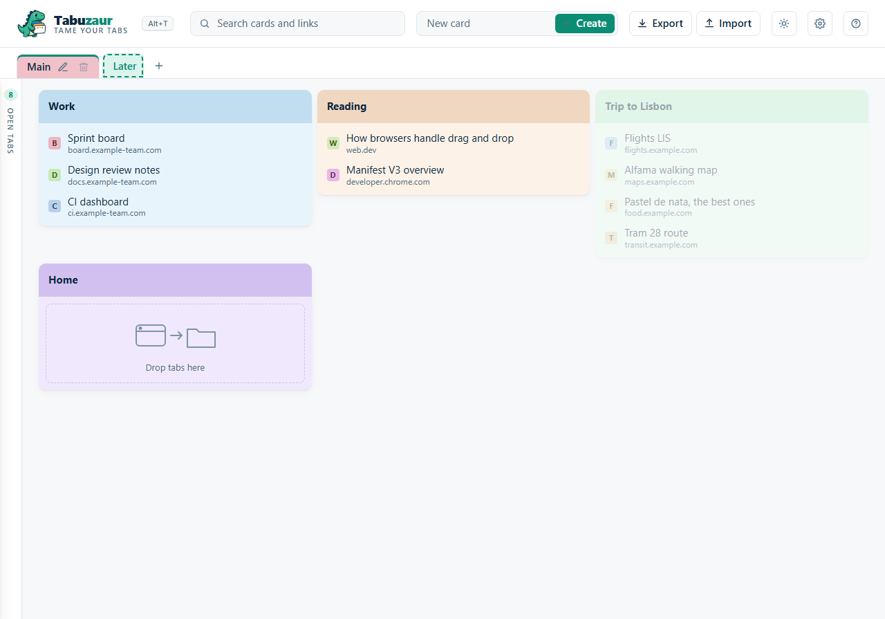

# Tabuzaur

*Tame your tabs.*

[](https://github.com/meet-brad-ch/Tabuzaur/actions/workflows/build.yml)
[](https://github.com/meet-brad-ch/Tabuzaur/releases/latest)
[](https://github.com/meet-brad-ch/Tabuzaur/actions/workflows/build.yml)
[](LICENSE)


Tabuzaur is a Chrome extension that keeps the pages you work with as links in cards. You fill a
card from the tabs that are open, by dragging. Cards sit in collections, and each collection has
its tab at the top of the page. A saved link jumps to its tab when the tab is open, and opens the
page when it is not. All data stays on your computer: there is no account, no sync and no network
request.


## Install in two minutes

1. Download `Tabuzaur-vX.Y.Z.zip` from the [latest release](https://github.com/meet-brad-ch/Tabuzaur/releases/latest).
2. Unzip it into a folder that stays. Chrome loads the extension from that folder each time it starts.
3. Open `chrome://extensions` and enable **Developer mode**, top right.
4. Click **Load unpacked** and choose the unzipped folder.
5. The Tabuzaur card appears, and the help page opens once.


To update: unzip the new release over the same folder, then click the reload icon on the card.

## Open Tabuzaur

- **The toolbar button.** Click the dinosaur next to the address bar.
- **Alt+T.** Chrome assigns this key at install when no other extension uses it. The page header
  shows the key in effect. If it shows "No shortcut assigned", click it and set a key on
  `chrome://extensions/shortcuts`.
- **Every new tab.** Off by default. Open Settings with the gear in the header and tick
  **Open Tabuzaur in every new tab**. Then a new blank tab shows the Tabuzaur page.
  When the window already has a Tabuzaur tab, Ctrl+T lands on that one instead of opening a copy.
  A window keeps one Tabuzaur tab: when one is active, its copies in that window close.
- **Start page.** Copy the ID from the Tabuzaur card. In Chrome Settings, open **On startup**,
  choose **Open a specific page or set of pages**, click **Add a new page** and enter
  `chrome-extension://<id>/tabs.html`.


## Everyday use

- **Open tabs.** The thin rail on the left shows how many tabs are open. Rest the pointer on it
  and the panel opens with every open tab, grouped by window. The pin keeps it open as a column.
- **Collections.** The bar under the header has one tab per collection. Click a tab to open it.
  The + at the end of the bar makes a new collection, and its tab gets its own color. The pen on the open tab, or a double click,
  renames it. Drag a tab along the bar to change the order. The trash deletes an empty collection.
  Tabuzaur keeps the last collection, and it remembers which collection was open.
- **Create a card.** Type a name in the field **New card** in the header and click Create. Tabuzaur
  adds the card to the open collection and gives it its own color. The card keeps that color.
- **Add a link.** Drag a tab from the panel onto a card. The tab stays open. Tabuzaur refuses a link
  that is already in that card, with a notice.
- **Open a link.** Click the link row. Tabuzaur jumps to the open tab with that address, or opens
  the page in a new tab.
- **Arrange.** Drag a link up or down, or onto another card. Drag a card by its colored band to
  another place, or onto a tab to move it to that collection. A green line shows where the drop
  lands. To reach a card lower on the page, hold the drag near the top or the bottom edge of the
  cards. The page scrolls.
- **Edit.** Rest the pointer on a link and click the pen to change its title or address. The pen in
  a band renames the card. The cross removes a link. The trash icon deletes a card after a question.
- **Find.** Type in the search field. The open collection shows only the cards with a match, and
  Tabuzaur marks the match. Every tab shows how many of its cards match.
- **Theme.** The round button cycles through system, light and dark.
- **Settings.** The gear opens the settings: a bar with three steps for the card width (Small,
  Medium, Large) and the new-tab option.
- **Help.** The `?` button opens the help page, the same one that opens after install.



## Backup

**Export** downloads every collection with its cards as one JSON file,
`tabuzaur-backup-YYYY-MM-DD.json`. **Import** reads such a file and asks what to do:

- **Replace** removes everything you have and loads the file.
- **Merge** adds the file to what you have. A collection joins the collection with the same name.
  A card joins the card with the same name in that collection. Links you already have stay.
  Nothing is removed.
- **A file from Tabuzaur 0.8 or earlier** holds cards only. Tabuzaur imports it into the open
  collection. Merge adds its cards there. Replace replaces the cards of that collection. The other
  collections stay.

The same file carries your collections to another computer. Tabuzaur 0.8 and earlier cannot read
a file from this version. Update the other computer first.

## Privacy

Tabuzaur asks for two permissions: `tabs`, to list and open tabs, and `storage`, to keep your
collections, cards and settings. It stores everything in Chrome's local storage. It makes no
network request, not even for a font.

## Development

Prerequisites: Node 24, npm 11, Chrome. Built with Node 24.19.0 and npm 11.17.0.

```
npm ci                 # install the pinned toolchain
npm run build          # vite build -> dist/ (the unpacked extension)
npm run verify         # eslint + tsc --noEmit + vitest + vite build: the gate
npm run shots          # render the help pictures headless (needs Chrome and Python with Pillow)
npm run check:page     # drive the built page headless and check drags, focus and storage (needs Chrome)
```

Load `dist/` with **Load unpacked** to run a development build. After a rebuild, click the reload
icon on the card.

Releases are built by CI from a tag `v<version>`. The tag must equal the version in
`public/manifest.json`, which must equal the version in `package.json`. The build job runs the
gate, zips `dist/` and publishes the zip with its SHA-256 as a GitHub Release.

### Layout

- `public/manifest.json` — the extension manifest, copied verbatim into `dist/`
- `tabs.html`, `src/tabs/` — the Tabuzaur page: a controller, a renderer and one view per region (header, collection bar, panel, cards), the dialogs, drag and drop
- `help.html`, `src/help/` — the help page
- `src/background.ts` — the service worker: toolbar button, Alt+T, help on first install, one Tabuzaur tab per window, the optional new-tab page
- `src/lib/` — the library model (collections of cards of links) and its operations, the document reader with the upgrade from 0.8, merge and import rules, search, the settings record, the backup file format, the Chrome tab adapter
- `src/shared/tokens.css` — colors and the dark theme, shared by both pages
- `tests/` — Vitest unit tests of `src/lib/` with in-memory fakes, and `tests/views/` for the views on happy-dom
- `tools/render/` — the headless render of the page for the help pictures, the headless page check, and a showcase backup to import
- `public/help/img/` — the pictures the help page and this README use
- `public/icons/`, `branding/` — the extension icons and the brand showcase they come from
- `.github/workflows/build.yml` — CI

### Design

- Manifest V3. The only background code is a module service worker. It handles the toolbar click,
  the Alt+T command, the first-install hook and the tab events for the one-tab rule and the
  new-tab option. It keeps no state and reads the settings on every event.
- Permissions are `tabs` and `storage`. All data lives in `chrome.storage.local`.
- A link is a saved page. A card groups links and has a name and a color. A collection groups
  cards, has a name and a color, and is a tab of the page. A file from 0.9.0 has no tab colors:
  each collection gets the color of its place. The stored document (schema 2) holds collections of cards of
  links. A card id is unique in the whole document.
- On the first load of a document of 0.8 or earlier (schema 1, cards only), Tabuzaur copies it
  unchanged to `tabuzaur-backup-v1`. Then it reads the document as one collection Main and saves
  it in the new form.
- The settings (theme, card width, pinned panel, new-tab option, open collection) are one record
  under one key.
- Three layers. Pure logic in `src/lib/` has unit tests in Node with fakes. Only thin adapters
  touch the Chrome API. In `src/tabs/`, a controller runs every user action, a
  renderer rebuilds the regions, and the views only build DOM. The views are tested on happy-dom,
  and `npm run check:page` drives the built page in headless Chrome.
- The lint gate checks simple code rules. Functions stay small, with low complexity and one
  statement per line. Every function sits in a class, and every class and method has a doc comment.
- The welcome page is Chrome's startup-page setting, not a new-tab override. Ctrl+T stays Chrome's
  until the user enables the new-tab option. That option uses the tabs API on new blank tabs, and
  the user can disable it again.
- TypeScript, Vite, Vitest and ESLint. Plain Vite with fixed entry names and relative asset paths.
- Brand, from `branding/showcase.png`: navy `#0f283d`, green `#0a8d73` and `#36b88f`, mint
  `#dbf5ec`, tagline grey `#506f85`. The mascot on a transparent background is the icon.

## License

[MIT](LICENSE).
