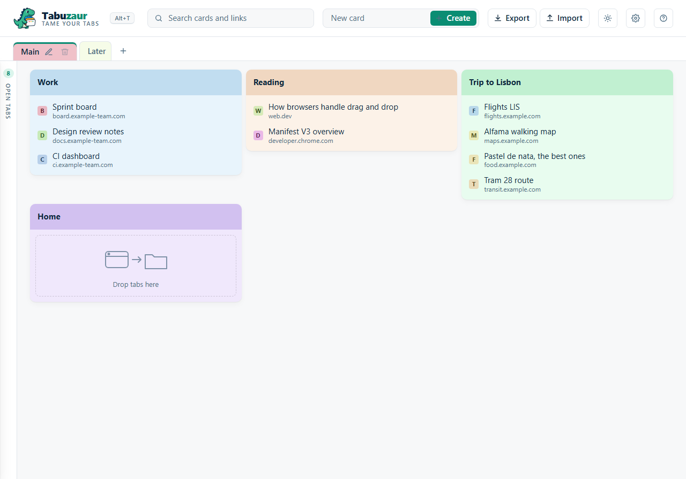
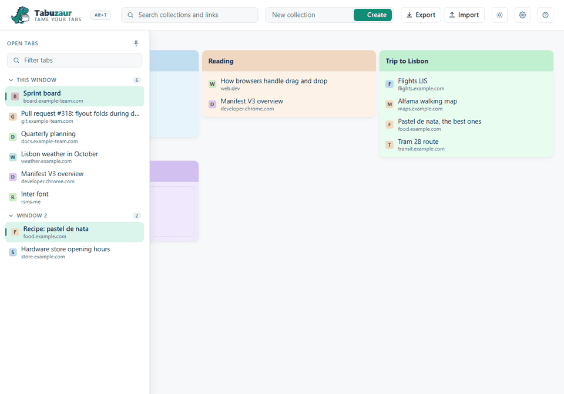
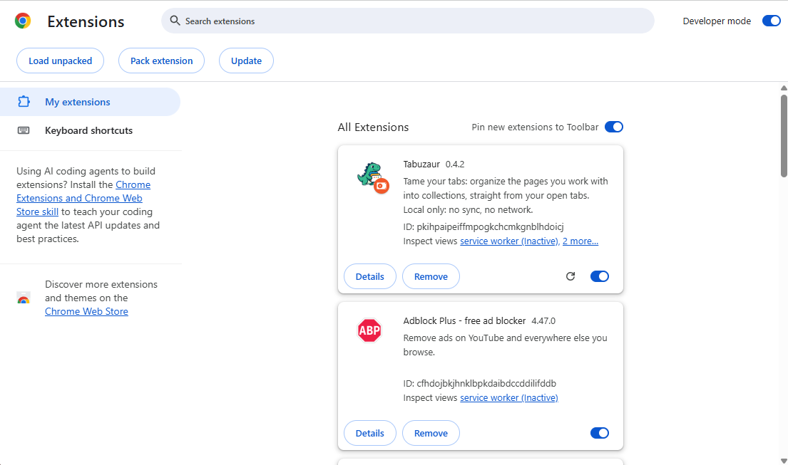
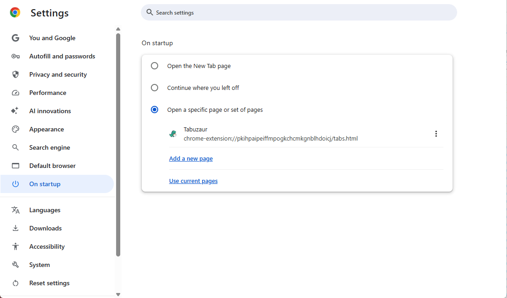
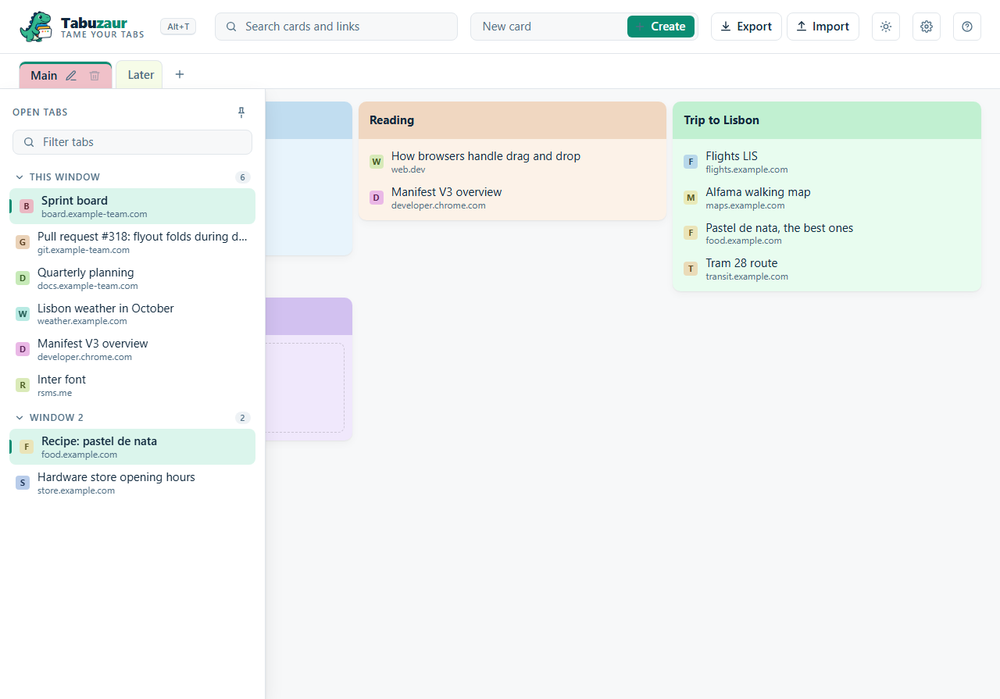

# Tabuzaur

*Tame your tabs.*

[](https://github.com/meet-brad-ch/Tabuzaur/actions/workflows/build.yml)
[](https://github.com/meet-brad-ch/Tabuzaur/releases/latest)
[](https://github.com/meet-brad-ch/Tabuzaur/actions/workflows/build.yml)
[](LICENSE)


Tabuzaur is a Chrome extension that keeps the pages you work with in collections. You build a
collection from the tabs that are open, by dragging. A saved link jumps to its tab when the tab is
open, and opens the page when it is not. All data stays on your computer: there is no account, no
sync and no network request.





## Install in two minutes

1. Download `Tabuzaur-vX.Y.Z.zip` from the [latest release](https://github.com/meet-brad-ch/Tabuzaur/releases/latest).
2. Unzip it into a folder that stays. Chrome loads the extension from that folder each time it starts.
3. Open `chrome://extensions` and enable **Developer mode**, top right.
4. Click **Load unpacked** and choose the unzipped folder.
5. The Tabuzaur card appears, and the help page opens once.



To update: unzip the new release over the same folder, then click the reload icon on the card.

## Open Tabuzaur

- **The toolbar button.** Click the dinosaur next to the address bar.
- **Alt+T.** Chrome assigns this key at install when no other extension uses it. The page header
  shows the key in effect. If it shows "No shortcut assigned", click it and set a key on
  `chrome://extensions/shortcuts`.
- **Every new tab.** Off by default. Open Settings with the gear in the header and tick
  **Open Tabuzaur in every new tab**. A new blank tab then shows the Tabuzaur page.
- **Start page.** Copy the ID from the Tabuzaur card. In Chrome Settings, open **On startup**,
  choose **Open a specific page or set of pages**, click **Add a new page** and enter
  `chrome-extension://<id>/tabs.html`.



## Everyday use

- **Open tabs.** The thin rail on the left shows how many tabs are open. Rest the pointer on it
  and the panel opens with every open tab, grouped by window. The pin keeps it open as a column.
- **Create a collection.** Type a name in the header field and click Create. Each collection gets
  its own color, and keeps it.
- **Add a link.** Drag a tab from the panel onto a collection. The tab stays open. Tabuzaur refuses a
  link that is already in that collection, with a notice.
- **Open a link.** Click the link row. Tabuzaur jumps to the open tab with that address, or opens
  the page in a new tab.
- **Arrange.** Drag a link up or down, or onto another collection. Drag a collection by its colored
  band to another place. A green line shows where the drop lands. To reach a collection below the
  fold, hold the drag near the top or the bottom edge of the collections and the page scrolls.
- **Edit.** Rest the pointer on a link and click the pen to change its title or address. The pen in
  a band renames the collection. The cross removes a link. The trash icon deletes a collection
  after a question.
- **Find.** Type in the search field. Only collections with a match stay, and Tabuzaur marks the match.
- **Theme.** The round button cycles through system, light and dark.
- **Help.** The `?` button opens the help page, the same one that opens after install.



## Backup

**Export** downloads all collections as one JSON file, `tabuzaur-backup-YYYY-MM-DD.json`.
**Import** reads such a file and asks what to do:

- **Replace** removes the collections you have and loads the file.
- **Merge** adds the file to what you have. Collections with the same name join, links you
  already have stay, nothing is removed.

The same file carries collections to another computer.

## Privacy

Tabuzaur asks for two permissions: `tabs`, to list and open tabs, and `storage`, to keep the
collections. It stores everything in Chrome's local storage. It makes no network request, not
even for a font.

## Development

Prerequisites: Node 24, npm 11, Chrome. Built with Node 24.19.0 and npm 11.17.0.

```
npm ci                 # install the pinned toolchain
npm run build          # vite build -> dist/ (the unpacked extension)
npm run verify         # eslint + tsc --noEmit + vitest + vite build: the gate
npm run shots          # render the help pictures headless (needs Chrome and Python with Pillow)
```

Load `dist/` with **Load unpacked** to run a development build. After a rebuild, click the reload
icon on the card.

Releases are built by CI from a tag `v<version>`. The tag must equal the version in
`public/manifest.json`, which must equal the version in `package.json`. The build job runs the
gate, zips `dist/` and publishes the zip with its SHA-256 as a GitHub Release.

### Layout

- `public/manifest.json` — the extension manifest, copied verbatim into `dist/`
- `tabs.html`, `src/tabs/` — the Tabuzaur page: open-tab panel, collection cards, drag and drop
- `help.html`, `src/help/` — the help page
- `src/background.ts` — the service worker: toolbar button, Alt+T, help on first install
- `src/lib/` — collection model and operations, the local store and its parser, the backup file format, URL helpers, the Chrome tab adapter
- `src/shared/tokens.css` — colors and the dark theme, shared by both pages
- `tests/` — Vitest unit tests of `src/lib/` with in-memory fakes
- `tools/render/` — the headless render of the page for the help pictures, and a showcase backup to import
- `public/help/img/` — the pictures the help page and this README use
- `public/icons/`, `branding/` — the extension icons and the brand showcase they come from
- `.github/workflows/build.yml` — CI

### Design

- Manifest V3. The only background code is a module service worker. It handles the toolbar click,
  the Alt+T command and the first-install hook. Nothing runs while no Tabuzaur page is open.
- Permissions are `tabs` and `storage`. All data lives in `chrome.storage.local`.
- A collection is a hand-made folder of links. The stored document holds collections, each with
  an id, a name, a color and its links. Older documents without colors get them on first load.
- Pure logic sits in `src/lib/` behind adapter interfaces and is unit-tested in Node with fakes.
  The Chrome API is touched only in thin adapters. The DOM code in `src/tabs/` is checked by the
  headless render and by hand in Chrome.
- The welcome page is Chrome's startup-page setting, not a new-tab override, so Ctrl+T stays
  Chrome's unless the user turns on the new-tab option. That option works through the tabs API
  on freshly created blank tabs and can be turned off again.
- TypeScript, Vite, Vitest and ESLint. Plain Vite with fixed entry names and relative asset paths.
- Brand, from `branding/showcase.png`: navy `#0f283d`, green `#0a8d73` and `#36b88f`, mint
  `#dbf5ec`, tagline grey `#506f85`. The mascot on a transparent background is the icon.

## License

[MIT](LICENSE).
